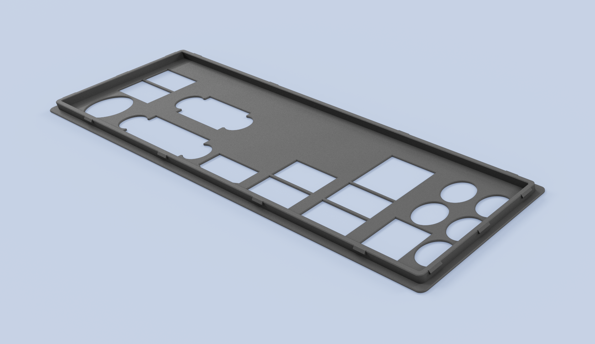

# Mainboard I/O shield replacements

A collection of pre-made, print-ready I/O shields.

Using the template, our designs and OpenSCAD you can easily model your own I/O shield. Feel free to open a pull request to expand this collection.

## ASRock B75 Pro3-M

[Design files, motherboard alignment and dimensioned drawings](designs/asrock-b75-pro3-m/README.md)

