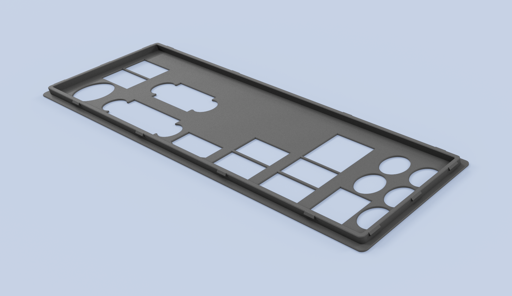
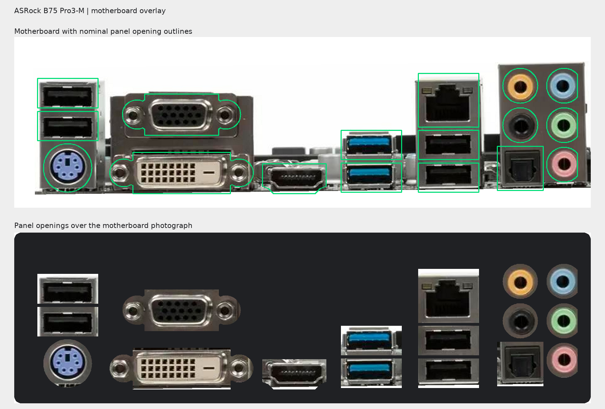
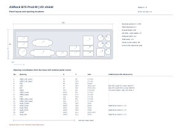
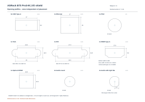
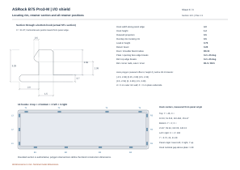

# I/O shield for ASRock B75 Pro3-M

[OpenSCAD](asrock-b75-pro3-m_v01.scad) · [Inventor](asrock-b75-pro3-m_v01.ipt) · [STEP](asrock-b75-pro3-m_v01.step) · [STL](asrock-b75-pro3-m_v01.stl) · [DXF](asrock-b75-pro3-m_v01.dxf)

## Motherboard overlay

## Dimensioned drawings

All dimensions are in millimeters.

### Panel layout

[SVG](drawings/01-panel-layout.svg)

### Panel openings

[SVG](drawings/02-opening-profiles.svg)

### Rim and retainers

[SVG](drawings/03-rim-retainers.svg)

Based on [rvbg's blank template](../../template/blank_v01.scad), modified for this motherboard.
